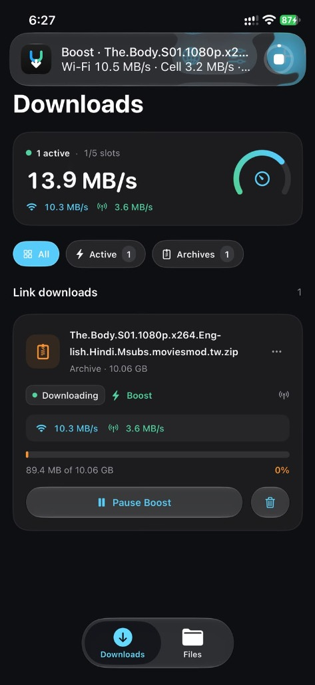
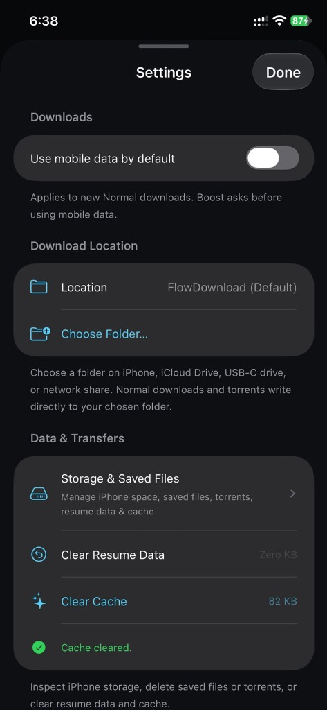

<p align="center">
  
</p>

<h1 align="center">FlowDownload</h1>

<p align="center">
  <strong>Multi-path Wi-Fi + Cellular Boost download manager, native torrent client, and external USB exporter for iOS.</strong>
</p>

<p align="center">
  <a href="https://muhammad-favel.github.io/FlowDownload-Releases/">Website</a> ·
  <a href="https://github.com/Muhammad-Favel/FlowDownload-Installer/releases">Desktop USB Installer</a> ·
  <a href="https://github.com/Muhammad-Favel/FlowDownload-Releases/releases">Releases</a> ·
  <a href="https://github.com/Muhammad-Favel/FlowDownload-Releases/issues">Report an Issue</a>
</p>

---

## Install on iOS

- **Desktop USB Installer (Windows & macOS):** Download from [FlowDownload-Installer Releases](https://github.com/Muhammad-Favel/FlowDownload-Installer/releases).
- **Direct `.ipa` (TrollStore / Sideloadly / Feather):** Download from [GitHub Releases](https://github.com/Muhammad-Favel/FlowDownload-Releases/releases).

---

## Screenshots

<p align="center">
  
  
  
  
</p>

---

## Key Capabilities

| Feature | What it does |
| --- | --- |
| **Wi-Fi + Cellular Boost** | Bonds `en0` (Wi-Fi) and `pdp_ip0` (Cellular) concurrently for HTTP Range downloads and torrent peers |
| **Native Libtorrent Core** | Embedded C++ `LibtorrentNative` engine with magnet links, `.torrent` files, pause/resume, and buffered disk I/O |
| **External USB Storage** | Stages downloads on fast internal APFS and exports sequentially to Lightning or USB-C drives without write stalls |
| **In-App Browser & Extensions** | Content-blocking browser with tab persistence, Share Sheet extension, and Safari Web Extension |
| **SHA-256 Verification** | Discovers companion `.sha256` files or pasted hashes to validate completed downloads |

---

## Measured Boost Benchmark (`BN-01` – `BN-03`, iPhone 12 Pro)

| Test ID | Mode | Avg Speed | Notes |
| --- | --- | --- | --- |
| `BN-01` | Wi-Fi Only | `6.44 MB/s` | `8.14 MB/s` steady-state, `10.44 MB/s` peak |
| `BN-02` | Cellular Only | `1.51 MB/s` | `4.12 MB/s` peak |
| `BN-03` | **Boost (Wi-Fi + Cellular)** | **`7.80 MB/s`** | **98% of single-radio sum (`+21%` vs Wi-Fi only, `10.09 MB/s` peak)** |

---

## Local Site Preview

```bash
python3 -m http.server 8080
```
