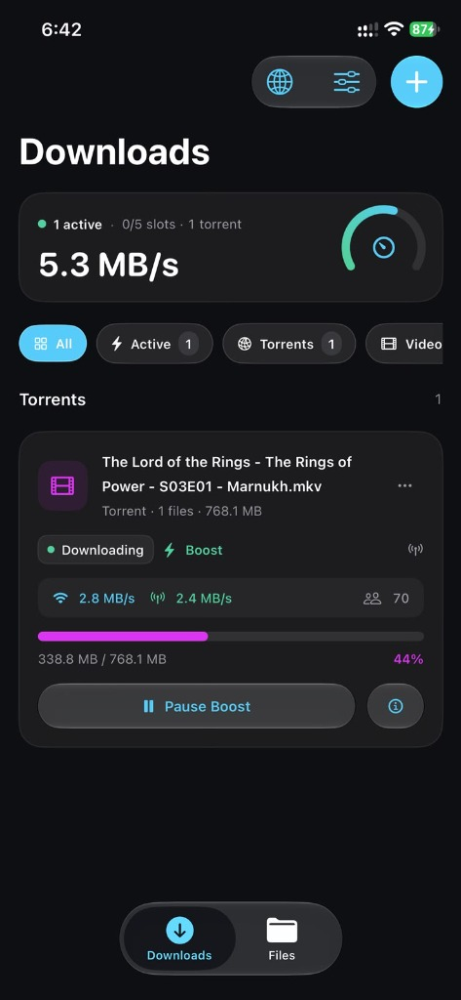
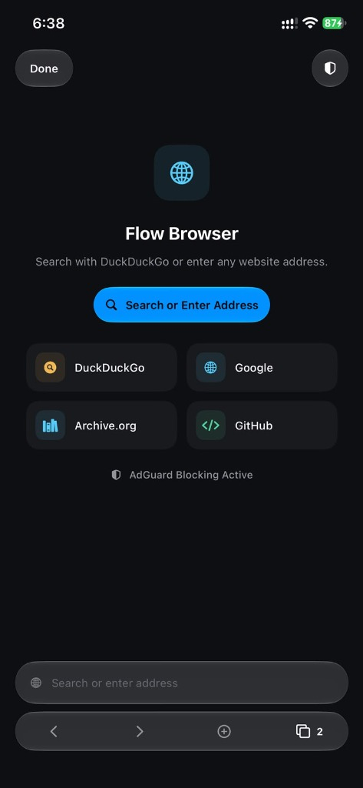
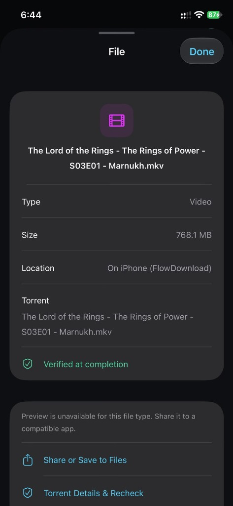
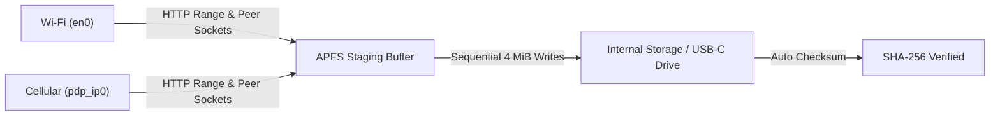

<<<<<<< HEAD

  

<h1 align="center">FlowDownload</h1>

  <strong>Bond Wi-Fi and Cellular into one download stream on iOS &amp; Android — with native torrents, external USB export, and automatic SHA-256 verification.</strong>

  
  
  
  
  

  <a href="https://muhammad-favel.github.io/FlowDownload-Releases/">Website</a> ·
  <a href="#how-to-install">Install</a> ·
  <a href="#screenshots">Screenshots</a> ·
  <a href="#how-boost-works">Architecture</a> ·
  <a href="#measured-boost-benchmark-bn-01--bn-03-iphone-12-pro">Benchmark</a> ·
  <a href="https://github.com/Muhammad-Favel/FlowDownload-Releases/issues">Report an Issue</a>

  

  <a href="https://muhammad-favel.github.io/FlowDownload-Releases/assets/flowdownload-demo.mp4">Watch 1080p MP4 (30s)</a>

---

## How to Install

| Platform | Method | Package | Size | Direct Link |
| :--- | :--- | :--- | :---: | :--- |
| **iOS** (`17.0+`) | **Desktop USB Installer** (Windows) | `.exe` / `.msi` | `5.3 MB` | [Download Windows Installer](https://github.com/Muhammad-Favel/FlowDownload-Installer/releases/download/v0.1.0/FlowDownload-Installer-v0.1.0-windows-x64.exe) |
| **iOS** (`17.0+`) | **Desktop USB Installer** (macOS) | `.dmg` | `7.6 MB` | [Download macOS Installer](https://github.com/Muhammad-Favel/FlowDownload-Installer/releases/download/v0.1.0/FlowDownload-Installer-v0.1.0-macos-arm64.dmg) |
| **iOS** (`17.0+`) | **Direct IPA** (TrollStore / Sideloadly / Feather) | `.ipa` | `12.6 MB` | [Download FlowDownload-v1.0.0.ipa](https://github.com/Muhammad-Favel/FlowDownload-Releases/releases/download/v1.0.0/FlowDownload-v1.0.0.ipa) |
| **Android** (`8.0+`) | **Direct APK** (`arm64-v8a` &amp; `x86_64`) | `.apk` | `26.4 MB` | [Download FlowDownload-v1.0.0.apk](https://github.com/Muhammad-Favel/FlowDownload-Releases/releases/download/v1.0.0/FlowDownload-v1.0.0.apk) |

### 1. iOS via Windows (Desktop USB Installer)
1. Ensure **Apple Devices** (or iTunes) is installed on Windows for Apple USB driver support.
2. Download and run [FlowDownload-Installer-v0.1.0-windows-x64.exe](https://github.com/Muhammad-Favel/FlowDownload-Installer/releases/download/v0.1.0/FlowDownload-Installer-v0.1.0-windows-x64.exe) (or `.msi` from [Installer Releases](https://github.com/Muhammad-Favel/FlowDownload-Installer/releases/tag/v0.1.0)).
3. Connect your iPhone via USB and tap **Trust This Computer**.
4. Pick an App ID profile (**Full**, **Share Only**, or **Core**), sign in with your Apple ID + 6-digit 2FA code, and wait for installation to finish.
5. On first sideload: enable **Developer Mode** (*Settings → Privacy & Security → Developer Mode*) and trust your Apple ID (*Settings → General → VPN & Device Management*).

### 2. iOS via macOS (Desktop USB Installer)
1. Download [FlowDownload-Installer-v0.1.0-macos-arm64.dmg](https://github.com/Muhammad-Favel/FlowDownload-Installer/releases/download/v0.1.0/FlowDownload-Installer-v0.1.0-macos-arm64.dmg) and drag **FlowDownload Installer** to Applications.
2. Connect your iPhone via USB and tap **Trust This Computer**.
3. Pick an App ID profile (**Full**, **Share Only**, or **Core**), sign in with your Apple ID + 6-digit 2FA code, and install.
4. On first sideload: enable **Developer Mode** and trust your Apple ID in *Settings → General → VPN & Device Management*.

### 3. iOS via Direct `.ipa` (TrollStore / Sideloadly / Feather)
1. Download [FlowDownload-v1.0.0.ipa](https://github.com/Muhammad-Favel/FlowDownload-Releases/releases/download/v1.0.0/FlowDownload-v1.0.0.ipa).
2. Open the `.ipa` in **TrollStore** (permanent install on supported iOS versions) or sign with **Sideloadly** / **Feather**.

### 4. Android (Direct `.apk`)
1. Download [FlowDownload-v1.0.0.apk](https://github.com/Muhammad-Favel/FlowDownload-Releases/releases/download/v1.0.0/FlowDownload-v1.0.0.apk) (`arm64-v8a` &amp; `x86_64`, Android 8.0+).
2. Open the `.apk` on your Android device and allow *Install unknown apps* if prompted.
3. Optional SHA-256 check: `f79abc2f18d80419d4081728ede0f6ed8432c0f83838cee5210a40b4675434f1`.

### iOS 3-App-ID Budget & 7-Day Refresh

[FlowDownload Installer](https://github.com/Muhammad-Favel/FlowDownload-Installer) tracks your **7-day signature** for in-place USB refresh without losing app data, and lets you choose an App ID budget:

| Profile | App IDs | Included | Trade-Off |
| :--- | :---: | :--- | :--- |
| **Full** | `3` | Core app + Share Sheet + Safari extension | Uses all 3 free Apple ID slots |
| **Share Only** | `2` | Core app + Share Sheet handoff | Drops Safari toolbar popup |
| **Core** | `1` | Boost, `libtorrent`, AdGuard browser, USB export, SHA-256 | Drops Safari &amp; Share extensions |

> [!TIP]
> **Refreshing after 7 days:** Do **not** delete FlowDownload from your iPhone. Plug in via USB, sign in with the same Apple ID and profile, and your downloads, active torrents, and browser tabs stay intact.

---

## Screenshots

| Direct Boost (`13.9 MB/s`) | Torrent Boost (`70 peers`) | Flow Browser (`AdGuard`) | Storage & USB | SHA-256 Verified |
| :---: | :---: | :---: | :---: | :---: |
|  |  |  |  |  |

---

## How Boost Works

1. **Dual-Interface Dispatch:** Assigns HTTP byte-range chunks and `libtorrent` peer sockets explicitly across Wi-Fi (`en0`) and Cellular (`pdp_ip0`), with stalled-lane recovery and connection reuse.
2. **APFS Staging Buffer:** Coalesces out-of-order chunks on fast internal flash so network sockets never stall waiting on slow Lightning or USB-C drives.
3. **Sequential USB Export & SHA-256:** Streams sequential `4 MiB` blocks to external drives and validates companion `.sha256` files or pasted hashes automatically on completion.

---

## Core Capabilities

| Subsystem | iOS (`SwiftUI`) | Android (`Jetpack Compose`) |
| :--- | :--- | :--- |
| **Multi-Path Boost** | `NWPath` / `en0` + `pdp_ip0` range scheduler | `ConnectivityManager` Wi-Fi + Cellular bonding |
| **Torrent Engine** | Embedded C++ `LibtorrentNative` (`magnet:` &amp; `.torrent`) | Native NDK `libtorrent` (`arm64-v8a` &amp; `x86_64`) |
| **External Storage** | Security-scoped USB-C / Lightning export | Storage Access Framework (SAF) USB OTG export |
| **Built-in Browser** | Content-blocking `WKWebView` with AdGuard rules | AdGuard-backed WebView with tab persistence |
| **Integrity & Privacy** | Automatic SHA-256 verification · Zero telemetry | Automatic SHA-256 verification · Zero telemetry |

---

## Measured Boost Benchmark (`BN-01` – `BN-03`, iPhone 12 Pro)

| Test&nbsp;ID | Transport Mode | Avg&nbsp;Speed | Peak / Efficiency |
| :--- | :--- | :---: | :--- |
| `BN&#8209;01` | Wi-Fi Only | `6.44`&nbsp;MB/s | `8.14`&nbsp;MB/s steady-state · `10.44`&nbsp;MB/s peak |
| `BN&#8209;02` | Cellular Only | `1.51`&nbsp;MB/s | `4.12`&nbsp;MB/s peak |
| `BN&#8209;03` | **Boost (Wi-Fi + Cellular)** | **`7.80`**&nbsp;MB/s | **98% radio sum (`+21%` vs Wi-Fi · `10.09`&nbsp;MB/s peak)** |

---

## Contributors

- **Google Antigravity** (Google DeepMind) — Official Contributor

---

## Privacy & Verification

- **No telemetry or analytics:** Downloads, browser tabs, AdGuard rules, and diagnostics stay strictly on-device.
- **Android APK SHA-256:** `f79abc2f18d80419d4081728ede0f6ed8432c0f83838cee5210a40b4675434f1`
- **Local Site Preview:** `python3 -m http.server 8080`
=======

  

<h1 align="center">FlowDownload</h1>

  <strong>Bond Wi-Fi and Cellular into one download stream on iOS &amp; Android — with native torrents, external USB export, and automatic SHA-256 verification.</strong>

  
  
  
  
  

  <a href="https://muhammad-favel.github.io/FlowDownload-Releases/">Website</a> ·
  <a href="#how-to-install">Install</a> ·
  <a href="#screenshots">Screenshots</a> ·
  <a href="#how-boost-works">Architecture</a> ·
  <a href="#measured-boost-benchmark-bn-01--bn-03-iphone-12-pro">Benchmark</a> ·
  <a href="https://github.com/Muhammad-Favel/FlowDownload-Releases/issues">Report an Issue</a>

  

  <a href="https://muhammad-favel.github.io/FlowDownload-Releases/assets/FlowDownload-Infographic-Pro-2m.mp4">Watch 1080p MP4 with Voiceover &amp; SFX (2m 00s)</a>

---

## How to Install

| Platform | Method | Package | Size | Direct Link |
| :--- | :--- | :--- | :---: | :--- |
| **iOS** (`17.0+`) | **Desktop USB Installer** (Windows) | `.exe` / `.msi` | `5.3 MB` | [Download Windows Installer](https://github.com/Muhammad-Favel/FlowDownload-Installer/releases/download/v0.1.0/FlowDownload-Installer-v0.1.0-windows-x64.exe) |
| **iOS** (`17.0+`) | **Desktop USB Installer** (macOS) | `.dmg` | `7.6 MB` | [Download macOS Installer](https://github.com/Muhammad-Favel/FlowDownload-Installer/releases/download/v0.1.0/FlowDownload-Installer-v0.1.0-macos-arm64.dmg) |
| **iOS** (`17.0+`) | **Direct IPA** (TrollStore / Sideloadly / Feather) | `.ipa` | `12.6 MB` | [Download FlowDownload-v1.0.0.ipa](https://github.com/Muhammad-Favel/FlowDownload-Releases/releases/download/v1.0.0/FlowDownload-v1.0.0.ipa) |
| **Android** (`8.0+`) | **Direct APK** (`arm64-v8a` &amp; `x86_64`) | `.apk` | `26.4 MB` | [Download FlowDownload-v1.0.0.apk](https://github.com/Muhammad-Favel/FlowDownload-Releases/releases/download/v1.0.0/FlowDownload-v1.0.0.apk) |

### 1. iOS via Windows (Desktop USB Installer)
1. Ensure **Apple Devices** (or iTunes) is installed on Windows for Apple USB driver support.
2. Download and run [FlowDownload-Installer-v0.1.0-windows-x64.exe](https://github.com/Muhammad-Favel/FlowDownload-Installer/releases/download/v0.1.0/FlowDownload-Installer-v0.1.0-windows-x64.exe) (or `.msi` from [Installer Releases](https://github.com/Muhammad-Favel/FlowDownload-Installer/releases/tag/v0.1.0)).
3. Connect your iPhone via USB and tap **Trust This Computer**.
4. Pick an App ID profile (**Full**, **Share Only**, or **Core**), sign in with your Apple ID + 6-digit 2FA code, and wait for installation to finish.
5. On first sideload: enable **Developer Mode** (*Settings → Privacy & Security → Developer Mode*) and trust your Apple ID (*Settings → General → VPN & Device Management*).

### 2. iOS via macOS (Desktop USB Installer)
1. Download [FlowDownload-Installer-v0.1.0-macos-arm64.dmg](https://github.com/Muhammad-Favel/FlowDownload-Installer/releases/download/v0.1.0/FlowDownload-Installer-v0.1.0-macos-arm64.dmg) and drag **FlowDownload Installer** to Applications.
2. Connect your iPhone via USB and tap **Trust This Computer**.
3. Pick an App ID profile (**Full**, **Share Only**, or **Core**), sign in with your Apple ID + 6-digit 2FA code, and install.
4. On first sideload: enable **Developer Mode** and trust your Apple ID in *Settings → General → VPN & Device Management*.

### 3. iOS via Direct `.ipa` (TrollStore / Sideloadly / Feather)
1. Download [FlowDownload-v1.0.0.ipa](https://github.com/Muhammad-Favel/FlowDownload-Releases/releases/download/v1.0.0/FlowDownload-v1.0.0.ipa).
2. Open the `.ipa` in **TrollStore** (permanent install on supported iOS versions) or sign with **Sideloadly** / **Feather**.

### 4. Android (Direct `.apk`)
1. Download [FlowDownload-v1.0.0.apk](https://github.com/Muhammad-Favel/FlowDownload-Releases/releases/download/v1.0.0/FlowDownload-v1.0.0.apk) (`arm64-v8a` &amp; `x86_64`, Android 8.0+).
2. Open the `.apk` on your Android device and allow *Install unknown apps* if prompted.
3. Optional SHA-256 check: `f79abc2f18d80419d4081728ede0f6ed8432c0f83838cee5210a40b4675434f1`.

### iOS 3-App-ID Budget & 7-Day Refresh

[FlowDownload Installer](https://github.com/Muhammad-Favel/FlowDownload-Installer) tracks your **7-day signature** for in-place USB refresh without losing app data, and lets you choose an App ID budget:

| Profile | App IDs | Included | Trade-Off |
| :--- | :---: | :--- | :--- |
| **Full** | `3` | Core app + Share Sheet + Safari extension | Uses all 3 free Apple ID slots |
| **Share Only** | `2` | Core app + Share Sheet handoff | Drops Safari toolbar popup |
| **Core** | `1` | Boost, `libtorrent`, AdGuard browser, USB export, SHA-256 | Drops Safari &amp; Share extensions |

> [!TIP]
> **Refreshing after 7 days:** Do **not** delete FlowDownload from your iPhone. Plug in via USB, sign in with the same Apple ID and profile, and your downloads, active torrents, and browser tabs stay intact.

---

## Screenshots

| Direct Boost (`13.9 MB/s`) | Torrent Boost (`70 peers`) | Flow Browser (`AdGuard`) | Storage & USB | SHA-256 Verified |
| :---: | :---: | :---: | :---: | :---: |
|  |  |  |  |  |

---

## How Boost Works

1. **Dual-Interface Dispatch:** Assigns HTTP byte-range chunks and `libtorrent` peer sockets explicitly across Wi-Fi (`en0`) and Cellular (`pdp_ip0`), with stalled-lane recovery and connection reuse.
2. **APFS Staging Buffer:** Coalesces out-of-order chunks on fast internal flash so network sockets never stall waiting on slow Lightning or USB-C drives.
3. **Sequential USB Export & SHA-256:** Streams sequential `4 MiB` blocks to external drives and validates companion `.sha256` files or pasted hashes automatically on completion.

---

## Core Capabilities

| Subsystem | iOS (`SwiftUI`) | Android (`Jetpack Compose`) |
| :--- | :--- | :--- |
| **Multi-Path Boost** | `NWPath` / `en0` + `pdp_ip0` range scheduler | `ConnectivityManager` Wi-Fi + Cellular bonding |
| **Torrent Engine** | Embedded C++ `LibtorrentNative` (`magnet:` &amp; `.torrent`) | Native NDK `libtorrent` (`arm64-v8a` &amp; `x86_64`) |
| **External Storage** | Security-scoped USB-C / Lightning export | Storage Access Framework (SAF) USB OTG export |
| **Built-in Browser** | Content-blocking `WKWebView` with AdGuard rules | AdGuard-backed WebView with tab persistence |
| **Integrity & Privacy** | Automatic SHA-256 verification · Zero telemetry | Automatic SHA-256 verification · Zero telemetry |

---

## Measured Boost Benchmark (`BN-01` – `BN-03`, iPhone 12 Pro)

| Test&nbsp;ID | Transport Mode | Avg&nbsp;Speed | Peak / Efficiency |
| :--- | :--- | :---: | :--- |
| `BN&#8209;01` | Wi-Fi Only | `6.44`&nbsp;MB/s | `8.14`&nbsp;MB/s steady-state · `10.44`&nbsp;MB/s peak |
| `BN&#8209;02` | Cellular Only | `1.51`&nbsp;MB/s | `4.12`&nbsp;MB/s peak |
| `BN&#8209;03` | **Boost (Wi-Fi + Cellular)** | **`7.80`**&nbsp;MB/s | **98% radio sum (`+21%` vs Wi-Fi · `10.09`&nbsp;MB/s peak)** |

---

## Privacy & Verification

- **No telemetry or analytics:** Downloads, browser tabs, AdGuard rules, and diagnostics stay strictly on-device.
- **Android APK SHA-256:** `f79abc2f18d80419d4081728ede0f6ed8432c0f83838cee5210a40b4675434f1`
- **Local Site Preview:** `python3 -m http.server 8080`
>>>>>>> f9bb16b (Replace README demo video with FlowDownload-Infographic-Pro-2m.mp4)
